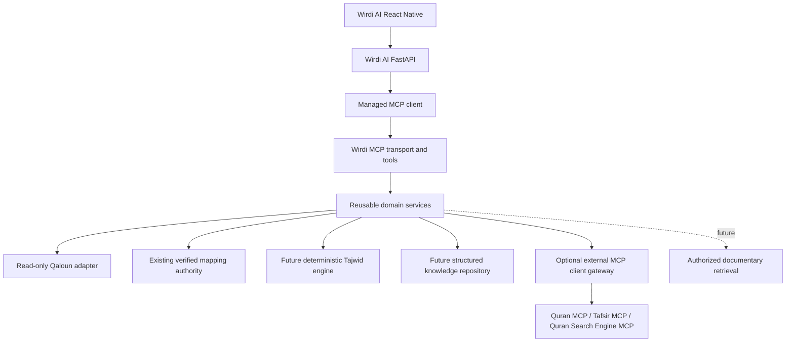

# Wirdi MCP

Independent, local-first Quranic knowledge infrastructure for future Wirdi AI
integration, with Qaloun through Abu Nashit as its explicit target scope.
Structured retrieval and verifiable evidence come before generated explanations.

**Current release: Phase 2 (0.2.0).** The stdio server exposes three read-only
tools: `health_check`, `get_qaloun_passage` and `resolve_source_mapping`.
Quran text is read directly from the original checksum-pinned Wirdi AI public
source files. No corpus copy, database, external provider, Tajwid detector, RAG
or agent is included.

The [source audit](docs/SOURCE_AUDIT.md) identifies the 6,214-ayah Qaloun corpus,
559-page verified map and existing mapper. The existing application was inspected
strictly read-only: no database connection, importer, migrations or private user
data. The corpus identifies Qaloun but does not independently attest Abu Nashit;
its honest metadata is `tariq=unspecified`. Path-specific requests are rejected.

## Start locally on Ubuntu

Requires Python 3.12+. From the project root:

```bash
python3 -m venv .venv
.venv/bin/python -m pip install -e '.[dev]'
.venv/bin/wirdi-mcp
# Equivalent: .venv/bin/python -m wirdi_mcp.server
```

The process waits for MCP input on stdin. It does not open a network listener.
Use an MCP host to launch it; typing ordinary text into it is not a tool call.
Logs go to stderr. `.env.example` documents logging and the public source root;
`.env` is not automatically loaded. To use the example explicitly:

```bash
cp .env.example .env
set -a
. ./.env
set +a
```

Set the existing repository root explicitly to enable data access:

```bash
export WIRDI_AI_ROOT=/home/najjar/Documents/Me/wirdi-Ai
.venv/bin/wirdi-mcp
```

Without this setting, diagnostics remain operational and both data tools return
`DATA_UNAVAILABLE`. Configuration is not proof of corpus integrity; data calls
check the pinned hashes on every request. Source changes require a reviewed
manifest update, never automatic trust or a fallback corpus.

A host configuration (replace paths with your own absolute paths):

```json
{
  "mcpServers": {
    "wirdi": {
      "command": "/absolute/path/wirdi-mcp/.venv/bin/wirdi-mcp",
      "args": [],
      "env": {
        "WIRDI_MCP_LOG_LEVEL": "INFO",
        "WIRDI_AI_ROOT": "/absolute/path/wirdi-Ai"
      }
    }
  }
}
```

The official [`mcp` Python SDK](https://github.com/modelcontextprotocol/python-sdk)
is pinned to the tested 2.3.0 release. This project uses its `MCPServer` API,
not the separately distributed `fastmcp` package or older v1 examples.

## Verify

```bash
.venv/bin/python -m pytest
.venv/bin/python -m pytest tests/integration/test_stdio.py -q
.venv/bin/ruff check .
.venv/bin/ruff format --check .
.venv/bin/python -m pip check
```

Normal tests use synthetic, non-Quran sentinels; real-source tests skip unless
explicitly enabled. Run the complete read-only conformance suite and a concise
real MCP verification against the existing public files:

```bash
WIRDI_TEST_SOURCE_ROOT=/home/najjar/Documents/Me/wirdi-Ai .venv/bin/python -m pytest -q
.venv/bin/python scripts/verify_local.py --source-root /home/najjar/Documents/Me/wirdi-Ai
.venv/bin/python -m hatchling build -t wheel
```

The stdio tests launch a real subprocess and check discovery, structured schemas,
passages, source mappings, errors and continued Tajwid unavailability. This Codex
execution sandbox restricts stdio subprocess I/O; these tests pass under its
authorized unsandboxed test execution. Normal Ubuntu execution uses the commands
above. No test connects to PostgreSQL or an external MCP service.

Results, exact changed files and limitations: [PHASE2_REPORT](docs/PHASE2_REPORT.md).
The original [FOUNDATION_REPORT](docs/FOUNDATION_REPORT.md) remains historical.

## Intended architecture



Every reference carries corpus version, numbering system, riwaya, and tariq.
Equal verse numbers never establish equal boundaries. Original text stays exact;
derived search forms and scholarly explanations must remain separate fields.
External material cannot become authoritative Qaloun text through fallback.

## Project guide

| Document | Contents |
| --- | --- |
| [SOURCE_AUDIT](docs/SOURCE_AUDIT.md) | Original corpus, checksums, pagination and selected read-only bridge |
| [ARCHITECTURE](docs/ARCHITECTURE.md) | Boundaries, reference identity, storage, security, extension points |
| [MCP_TOOLS](docs/MCP_TOOLS.md) | Seven proposed typed tool contracts, availability and failure semantics |
| [PROVIDERS](docs/PROVIDERS.md) | Dated capability audit, evidence levels, future adapter policy |
| [TAJWID_ENGINE](docs/TAJWID_ENGINE.md) | Rule, candidate, annotation, scholarly review and explanation separation |
| [INTEGRATION](docs/INTEGRATION.md) | FastAPI client, mapping authority reuse and staged migration |
| [ROADMAP](docs/ROADMAP.md) | Seven phases and release gates |
| [DECISIONS](docs/DECISIONS.md) | Decisions and their trade-offs |

Next milestone: Phase 3, optional external provider discovery and evidence normalization.
It remains unimplemented and disabled. Keep existing source checks and mapping admission intact.
