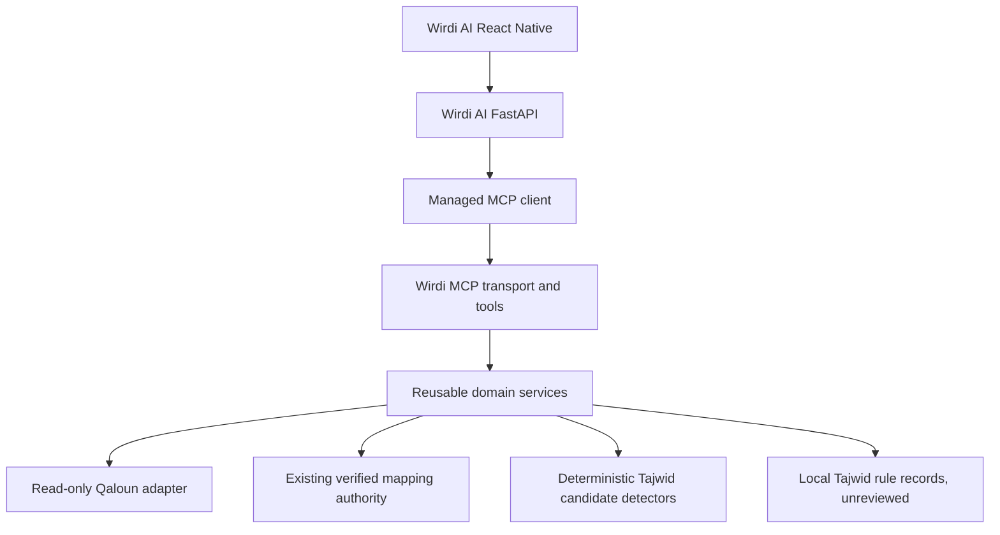

# Wirdi MCP

Independent, local-first Quranic knowledge infrastructure for future Wirdi AI
integration, with Qaloun through Abu Nashit as its explicit target scope.
Structured retrieval and verifiable evidence come before generated explanations.

**Current release: local Tajwid candidates (0.6.0).** The stdio server exposes
twelve read-only local tools: diagnostics, Qaloun passage and mapping tools, and
nine Tajwid tools. Quran text is read directly from the original checksum-pinned
Wirdi AI public source files. No external MCP client, network provider, database,
RAG, embedding or LLM is used. Eighty-one Tajwid rules are available as paraphrased,
page-cited, **unreviewed** records (14 from the first release, 67 from every section of
Book A: madd, hamza, heavy and light letters, taqlil, idgham, ya'at al-idafa), and
deterministic detectors propose **candidate** annotations for 79 of them. See
[BOOK_A_COVERAGE](docs/BOOK_A_COVERAGE.md) for what is and is not detected. Nothing is scholarly verified: there is no named reviewer, the
highest status ever served is `candidate`, and `get_tajwid_explanation` stays
unavailable.

The [source audit](docs/SOURCE_AUDIT.md) identifies the 6,214-ayah Qaloun corpus,
559-page verified map and existing mapper. The existing application was inspected
strictly read-only: no database connection, importer, migrations or private user
data. The corpus identifies Qaloun but does not independently attest Abu Nashit;
its honest metadata is `tariq=unspecified`. Path-specific requests are rejected.

## Start locally on Ubuntu

Requires Python 3.12+. From the project root:

```bash
python3 -m venv .venv
.venv/bin/python -m pip install -e '.[dev]'
.venv/bin/wirdi-mcp
# Equivalent: .venv/bin/python -m wirdi_mcp.server
```

The process waits for MCP input on stdin. It does not open a network listener.
Use an MCP host to launch it; typing ordinary text into it is not a tool call.
Logs go to stderr. `.env.example` documents logging and the public source root;
`.env` is not automatically loaded. To use the example explicitly:

```bash
cp .env.example .env
set -a
. ./.env
set +a
```

Set the existing repository root explicitly to enable Quran data access. Tajwid
rules are read from this repository's `knowledge/` directory (override with
`WIRDI_KNOWLEDGE_ROOT`):

```bash
export WIRDI_AI_ROOT=/home/najjar/Documents/Me/wirdi-Ai
.venv/bin/wirdi-mcp
```

Without this setting, diagnostics and rule lookup remain operational and every tool
that needs Quran text returns `DATA_UNAVAILABLE`. Configuration is not proof of corpus integrity; data calls
check the pinned hashes on every request. Source changes require a reviewed
manifest update, never automatic trust or a fallback corpus.

A host configuration (replace paths with your own absolute paths):

```json
{
  "mcpServers": {
    "wirdi": {
      "command": "/absolute/path/wirdi-mcp/.venv/bin/wirdi-mcp",
      "args": [],
      "env": {
        "WIRDI_MCP_LOG_LEVEL": "INFO",
        "WIRDI_AI_ROOT": "/absolute/path/wirdi-Ai"
      }
    }
  }
}
```

The official [`mcp` Python SDK](https://github.com/modelcontextprotocol/python-sdk)
is pinned to the tested 2.3.0 release. This project uses its `MCPServer` API,
not the separately distributed `fastmcp` package or older v1 examples.

Test categories:

```bash
.venv/bin/python -m pytest                                   # offline: unit + local stdio
WIRDI_TEST_SOURCE_ROOT=/abs/wirdi-Ai .venv/bin/python -m pytest   # adds read-only real-source tests
```

Mocked results are never live verification.

## Verify

```bash
.venv/bin/python -m pytest
.venv/bin/python -m pytest tests/integration/test_stdio.py -q
.venv/bin/ruff check .
.venv/bin/ruff format --check .
.venv/bin/python -m pip check
```

Normal tests use synthetic, non-Quran sentinels; real-source tests skip unless
explicitly enabled. Run the complete read-only conformance suite and a concise
real MCP verification against the existing public files:

```bash
WIRDI_TEST_SOURCE_ROOT=/home/najjar/Documents/Me/wirdi-Ai .venv/bin/python -m pytest -q
.venv/bin/python scripts/verify_local.py --source-root /home/najjar/Documents/Me/wirdi-Ai
.venv/bin/python -m hatchling build -t wheel
```

The stdio tests launch a real subprocess and check discovery, structured schemas,
passages, source mappings, errors and continued Tajwid unavailability. This Codex
execution sandbox restricts stdio subprocess I/O; these tests pass under its
authorized unsandboxed test execution. Normal Ubuntu execution uses the commands
above. No test connects to PostgreSQL, a network service or an external MCP server.

## Tools

| Tool | Purpose |
| --- | --- |
| `health_check` | Readiness and configuration, no data access |
| `get_qaloun_passage` | Unchanged Qaloun ayat with verified page spans |
| `resolve_source_mapping` | Existing pinned mapping authority |
| `list_tajwid_rules`, `get_tajwid_rule` | Rule records with book and page citations |
| `analyze_qaloun_tajwid` | Candidate occurrences for 1 to 100 ayat, paged, with rule filter |
| `summarize_tajwid` | Per-rule counts for a surah or range, with per-ayah counts |
| `analyze_app_page` | Candidates for the ayat that begin on a page of the verified 559-page layout |
| `get_tajwid_explanation` | `UNSUPPORTED_CAPABILITY` until a named reviewer validates annotations |
| `get_source_page`, `search_source_pages` | Locally placed source-book pages; fail closed when absent |
| `get_letter_properties` | Place of articulation and characteristics of 1 to 29 letters (Book A pp.40-45) |

Details, statuses and failure semantics are in [MCP_TOOLS](docs/MCP_TOOLS.md). Source
books are never in git: build the local page store from your own copy with
`scripts/build_page_store.py` (only PDFs with a real text layer; copy-protected PDFs are
refused).

## Intended architecture



Every reference carries corpus version, numbering system, riwaya, and tariq.
Equal verse numbers never establish equal boundaries. Original text stays exact;
derived search forms and scholarly explanations must remain separate fields.
No external material is queried or used as a fallback.

## Project guide

| Document | Contents |
| --- | --- |
| [SOURCE_AUDIT](docs/SOURCE_AUDIT.md) | Original corpus, checksums, pagination and selected read-only bridge |
| [ARCHITECTURE](docs/ARCHITECTURE.md) | Boundaries, reference identity, storage, security, extension points |
| [MCP_TOOLS](docs/MCP_TOOLS.md) | Local tool contracts, availability and failure semantics |
| [BOOK_A_COVERAGE](docs/BOOK_A_COVERAGE.md), [TESTING_GUIDE](docs/TESTING_GUIDE.md) | What Book A rule is detected, and requests to try every family |
| [NoteImportant](docs/NoteImportant.md) | Problèmes rencontrés, origine des données, analyse des résultats testés |
| [TAJWID_ENGINE](docs/TAJWID_ENGINE.md) | Rule, candidate, annotation, scholarly review and explanation separation |
| [INTEGRATION](docs/INTEGRATION.md) | FastAPI client, mapping authority reuse and staged migration |
| [ROADMAP](docs/ROADMAP.md) | Phases, gates and current state |
| [SOURCES_INTAKE](docs/SOURCES_INTAKE.md) | The three source PDFs: identity, shape, legend, path claims |
| [RULE_AUDIT](docs/RULE_AUDIT.md) | Per-rule detector frequencies over the whole corpus |
| [PILOT_REPORT](docs/PILOT_REPORT.md) | Coloured-mushaf pilot (NO-GO) and why |
| [PERF](docs/PERF.md), [E2E_REPORT](docs/E2E_REPORT.md) | Measured latency and a real stdio transcript |
| [HANDOFF](docs/HANDOFF.md), [DECISIONS](docs/DECISIONS.md), [BLOCKERS](docs/BLOCKERS.md), [PROGRESS](docs/PROGRESS.md) | Where the work stands and what needs a human |

The next milestone needs a **named qualified reviewer**: without one nothing can move
beyond `candidate`. Keep existing source checks and mapping admission intact.
