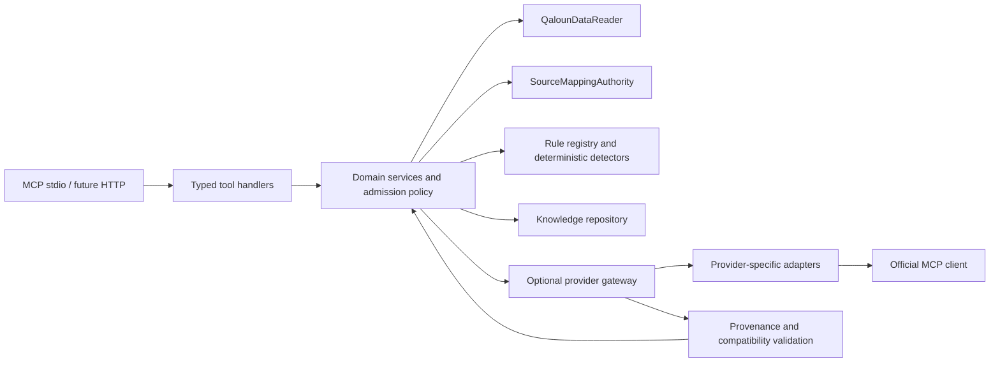

# Component architecture

Status: Phase 3 implemented, 0.3.0, 2026-10-30. Business schemas are v1.0;
transport protocol negotiation is separate. Diagnostic, direct read-only Qaloun
access, existing-authority source mapping and an opt-in outbound provider gateway
(`providers/`, two tools) are operational. Future Tajwid, RAG, agents and Wirdi AI
backend integration remain unimplemented.
See [SOURCE_AUDIT](SOURCE_AUDIT.md) for the read-only audit made before coding.

## Responsibilities and dependency direction

The server receives MCP requests and exposes approved tools. It is also intended
to host a separate outbound MCP client gateway. These are distinct roles:
inbound clients see Wirdi's stable contracts; outbound clients speak each
provider's discovered contract and never relay unchecked responses directly.

| Boundary | Owns | Must not own |
| --- | --- | --- |
| `server.py` | SDK lifecycle, registration and transport | Scholarly decisions, corpus rewriting |
| `tools/` | Parameter/result schemas and MCP error translation | Database queries or mapping algorithms |
| `domain/` | Reference/value contracts, future orchestration and read-only data port | FastAPI or mobile implementation details |
| `mapping/` | Pinned original mapper and narrow read-only dependency bridge | A second alignment algorithm |
| `quran/` | Metadata manifest, original public-file reads and exact text/page admission | Database startup or duplicate corpus |
| `providers/` | Catalog, request-scoped SDK client sessions, schema-signature admission, typed adapters, normalized unreviewed evidence | Qaloun authority inferred from tool names; generic tool passthrough; any corpus write |
| `knowledge/` package | Storage-independent scholarly records; future repository | Personal progress or user management |
| root `knowledge/` | Future reviewed metadata/rule files | Unlicensed books or duplicate corpus |

Future `domain/services.py`, `tajwid/`, and `validation/` modules will be added
when behavior exists. There are no empty `tafsir.py`, detector, registry, provider
implementation (beyond the two audited provider adapters), or repository modules pretending to work. A single
`tools/contracts.py` captures the proposed catalog. Structural guards currently
live beside their models; scientific validation remains a future service.

## Quran identity and immutable data

`QuranReference` requires `corpus_id`, `corpus_version`, `numbering_system`,
`riwaya`, `tariq`, `surah` and `ayah`. Unknown external metadata is represented
explicitly as unknown during quarantine; it cannot satisfy the Qaloun admission
gate. `QalounReference` restricts riwaya to `qaloun` and permits `unspecified` or
`abu_nashit` tariq. The audited active corpus accepts only `unspecified`; the
source metadata does not establish Abu Nashit.
These are application identifiers, not claims that all traditions fit one enum.

Pydantic enforces structural constraints (surah 1–114, strict positive integers
and bounded selection). The file adapter additionally enforces the pinned
manifest's actual per-surah limits, corpus/version, numbering and tariq.
Source hashes and structural checks establish machine integrity; scholarly
review remains a separate responsibility. Do not substitute Hafs limits, a 6,236-entry
dataset, a provider's global ID, or a 604-page edition for Wirdi's manifest.

`QalounFileAdapter` reads the original public JSON transcription and verified
pagination directly from the explicitly configured Wirdi AI root. It rechecks
file and ordered-text checksums on each request, retains only process memory,
and makes no new on-disk corpus. Missing files fail without database access.
The metadata-only `quran/source_manifest.json` pins 6,214 Qaloun records, 6,236
internal Hafs records, all per-surah counts, source revision, map and evidence.
The current page metadata covers 559 printed pages, with 459 spanning ayat.
No word-level page splitting is available. Additional future corpus admission
will require an authorized manifest. The manifest must include edition,
riwaya/tariq, numbering identity, version, total and per-surah counts, page-map
version, licensing/attribution, text encoding, exact hash procedure, and a
trusted artifact digest. The 6,214-ayah count and 559-page map have now been checked against the original
public files and existing verification reports; those reports are not newly
performed scholarly or scan audits.

Hash exact UTF-8 text bytes with SHA-256 without Unicode normalization, trimming,
diacritic removal, punctuation replacement, or join/split rewriting. Hash the
whole source artifact separately. Retain individual ayat as separate records;
any display joining is a derived view. Verify artifact identity before admitting
it and record per-record digests. Hash equality proves byte consistency with a
trusted artifact; it does not prove scientific authenticity by itself.

Search may build normalized keys in separate fields with a named normalization
version. Those keys must never overwrite canonical text or determine boundary
mapping. Token/word spans bind to the original text hash and use zero-based,
half-open Unicode codepoint offsets. JavaScript consumers must convert to UTF-16
indices explicitly; one-based word indices are display aids, not primary keys.

## Mapping authority

`WirdiSourceMappingAdapter` implements the existing authority port. It reads
checksum-pinned `mapping.py`, `arabic.py` and `schemas.py` from Wirdi AI and
executes their unchanged source in isolated namespaces. A limited
`ReadOnlyAuthorityView` supplies only the edition lookup and two-predicate ayah
query used by that pinned resolver, over validated public records. It rejects
unsupported operations; there is no SQL engine, application import, database
startup, `commit`, credential access or sibling bytecode write.

This temporary bridge binds dependencies, not the boundary algorithm. Any code
hash drift disables mapping pending review. Conformance reproduces all 6,214
single-selection statuses and all 473 original unresolved reference/reason
records. A separately reviewed pure shared library remains the future preferred
interface; extraction is outside this task because Wirdi AI must remain untouched.

Requests name source selection and explicit target corpus/version/numbering.
Responses retain native statuses, components, source metadata, difference/context
notices, reasons and precise technical evidence, plus full target identities.
`mapping_requires_review` is returned as diagnostic data with
`safe_for_source_retrieval=false`; missing links produce no same-number fallback.
Verified equivalent/different statuses mean machine-checked passage boundaries,
not scholarly approval, recitation identity or word-level alignment.

The frozen Phase 1 draft mapping shape was refined before its first public tool
registration to represent native ranges/components and review semantics honestly.
No nonexistent scholarly validation IDs are invented. Span-level alignments are
unsupported; split/merge components keep complete source context explicitly.

## Storage choice

Begin Phase 4 with version-controlled, licensed source/rule metadata and an
optional **SQLite knowledge artifact** built offline after review. Do not create
tables in this phase. SQLite avoids a database service for a single Ubuntu
process, supports relational constraints and reproducible distribution, and
fits a small read-mostly knowledge set. Open published artifacts in `mode=ro`
and enable `query_only`; reserve `immutable=1` for artifacts truly guaranteed
immutable. Do not silently create an empty database when a path is missing.

| Choice | Initial value | Cost / upgrade trigger |
| --- | --- | --- |
| SQLite | Simple local operations, one distributable audited artifact | Concurrent editorial writers, remote review workflows and cross-host access require more coordination |
| PostgreSQL | Strong multiuser concurrency and server-managed roles | Extra service, credentials and migrations; adopt when concurrent scholarly editorial work or deployment scale requires it |

A repository boundary will isolate storage; avoid adding an ORM or PostgreSQL
driver until needed. Keep Wirdi AI's PostgreSQL and its personal reading records
in the original backend. Neither choice justifies copying the Quran corpus.

Planned entities: scholarly sources → editions → cited rule definitions;
conditions and exceptions reference rules; Quran references anchor passage
annotations; validation records bind approvals to exact subject versions and
hashes. Explanations cite both rule and annotation records. See
[TAJWID_ENGINE](TAJWID_ENGINE.md) for the publication gate.

## Reliability, security and observability

Execution remains stdio only: no listening socket, no database connection and no
private user input. Provider connections are outbound-only, opt-in, created per
operation and closed afterwards; a bearer credential, if ever needed, is read from a
configured environment variable name and never logged or returned. The only source
configuration is an absolute public-file root; no caller-provided file paths are accepted. `health_check` reports process-level
foundation readiness, not corpus integrity or scholarly validity. Its configured/unconfigured flags are not source-integrity claims. It returns no
paths, environment values, host inventory, or credentials. Python logging writes
to stderr; stdout belongs to MCP.

Future tool handlers impose selection, query, response-byte and deadline limits.
External calls are opt-in with administrator-configured HTTPS origins or pinned
local executable/argument arrays, never a request-supplied URL or shell command.
Use domain/redirect allowlists and block unintended private-network destinations
to prevent SSRF. Deny unapproved discovered tools even if their annotations say
read-only. Apply schema checks and enforce response limits before parsing large
payloads. Source text is untrusted data, never instructions.

Credentials stay server-side in a secret store or restricted environment, with
least scope. Do not log authorization headers, raw provider payloads, search
history, or reading context. Retain only redacted request IDs, tool/provider IDs,
latency, stable error codes, and artifact versions as operational metrics.
Scholarly raw evidence retention requires a license-aware retention policy.

Local retrieval must never instantiate the external gateway. A provider failure
is isolated to that provider and cannot block local tools. Run independent
provider requests under bounded concurrency and cancellation. See
[PROVIDERS](PROVIDERS.md) for retry, fallback and admission policy.

Future Streamable HTTP must explicitly bind loopback during development and
add authentication, authorization scopes, origin/host validation, TLS at the
deployment boundary, rate limits and bounded sessions before shared deployment.
Read-only hints are descriptive metadata; the service must enforce permissions.

## Extension boundaries

Future `DocumentEvidenceRetriever.retrieve(query, source_ids, limit)` may return
licensed excerpts with edition/page/section, hashes, retrieval scores and
provenance. This is a conceptual port, deliberately not an installed module.
Qdrant and multilingual/Arabic embeddings are possible implementations only
after an evaluated documentary retrieval need. Similarity cannot approve a rule
or passage annotation, and retrieval failure must not affect deterministic tools.

A future single Tadabbur consumer may call only the versioned MCP catalog,
preserve claim-to-citation links and explicitly decline unsupported conclusions.
It receives structured candidates separately from verified results. No LLM,
agent framework, multi-agent system, vector store or embedding model is needed
for the current foundation.

Transport implementation follows the official SDK's
[server documentation](https://py.sdk.modelcontextprotocol.io/run/).
