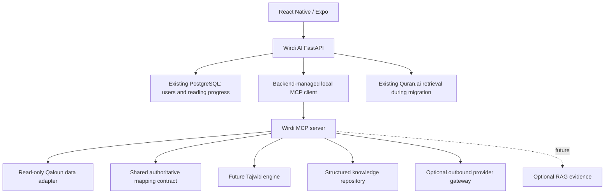

# Future Wirdi AI integration

Wirdi MCP is independent. Phase 2 inspected the existing `wirdi-Ai` public
source files, mapper and validation reports strictly read-only; no files were
modified and no database or private records were accessed. See
[SOURCE_AUDIT](SOURCE_AUDIT.md). This document describes future backend integration;
none was added to Wirdi AI in Phase 2.



## Local development and client lifecycle

Use stdio locally. FastAPI's lifespan will own the official SDK client and its
child process, starting it once per managed worker rather than once per request.
Configure an absolute interpreter/console-script path and explicit minimal
environment; do not depend on shell activation or a relative working directory.
Separate worker processes require separate stdio children, or later a shared
HTTP service. Bound concurrent requests, timeouts, cancellation and child restart
backoff, and ensure shutdown closes the client and reaps the child.

This standalone example uses the tested SDK API and can run after installing the
foundation. It illustrates a future backend consumer; no FastAPI dependency or
client is added to Wirdi AI here:

```python
import asyncio
from mcp import Client, StdioServerParameters


async def diagnostic():
    params = StdioServerParameters(
        command="/absolute/path/wirdi-mcp/.venv/bin/wirdi-mcp",
        env={
            "WIRDI_MCP_LOG_LEVEL": "WARNING",
            "WIRDI_AI_ROOT": "/absolute/path/wirdi-Ai",
        },
    )
    async with Client(params, read_timeout_seconds=5) as client:
        tools = await client.list_tools()
        assert {t.name for t in tools.tools} == {
            "health_check",
            "get_qaloun_passage",
            "resolve_source_mapping",
        }
        result = await client.call_tool("health_check", {})
        if result.is_error:
            raise RuntimeError("MCP diagnostic failed")
        return result.structured_content


if __name__ == "__main__":
    print(asyncio.run(diagnostic()))
```

In FastAPI, retain this `async with Client(...)` context for the entire lifespan,
not just the diagnostic. Validate structured responses against the agreed Wirdi
schema and its major version before using them. Check `is_error` first and
future domain `status` second. SDK client lifecycle and transport behavior are
documented in the official [client guide](https://py.sdk.modelcontextprotocol.io/client/)
and [transport guide](https://py.sdk.modelcontextprotocol.io/client/transports/).

## Reuse the existing mapping authority

Do not copy a mapping algorithm into this repository. Phase 2 selected direct
public-file access and an unchanged checksum-pinned mapper with a narrow read-only
dependency bridge. This avoids application startup and any PostgreSQL access.
No new corpus snapshot or mapping-result dataset was created. The bridge binds
only the original read calls and compiles trusted bytes without sibling pyc
writes. Code drift fails closed. Future alternatives remain:

| Option | Reuse mechanism | Fit / trade-off |
| --- | --- | --- |
| Shared independent package | Extract the existing verified implementation into a versioned library with no mobile/FastAPI dependency, consumed by both systems | Preferred if extraction preserves existing tests and can be reviewed in its own task |
| Versioned read-only service | Existing backend exposes only corpus/mapping operations through an authenticated service adapter | Avoids extraction but adds a runtime dependency; requests cannot carry private reading data |
| Immutable verified mapping artifact | Existing authority exports reviewed versioned correspondences with manifest and digest | Keeps local execution independent; supports only exported correspondence scopes and needs controlled updates |

These remain future alternatives. This task neither extracts the library nor
adds an endpoint. The `SourceMappingAuthority` port is now implemented by
`WirdiSourceMappingAdapter`; a shared library can replace its dependency bridge
without changing the tool catalog after conformance review.

Required shared v1 contract: source and target corpus/version/numbering identity,
riwaya/tariq manifests, bounded source selection, explicit many-to-many segments,
boundary relation/evidence, mapping version/artifact digest and review records.
For split/merge, Phase 2 retains the original complete-component coverage and
context notices. Ambiguous overlaps remain review-required. Future word-span
anchors need a separate agreed contract; the current verse-level result cannot
establish word alignment.

The consumer must verify manifest/digest, supported contract version, source
selection coverage, target identity and authority validation. Missing targets, stale artifacts and unsupported versions fail closed.
Ambiguous/unverified outcomes retain the original diagnostic status with
`safe_for_source_retrieval=false`; consumers must not use candidate ranges for
scholarly retrieval.
Equality of `(surah, ayah)` is never an identity proof.

Keep the existing mapper's golden tests as authority and run a shared conformance
suite against each adapter. Include splits, merges, unsupported spans and changed
corpus versions. No imported application implementation details should leak into
the stable reference contract.

## Phase 3 status

Phase 3 changes nothing in Wirdi AI. The application does not call Wirdi MCP today and
keeps its own `backend/app/tadabbur/mcp.py` client for quran.ai tafsir. The gateway tools
are consumable by any stdio MCP host once Phase 6 adds a managed client. Wirdi AI's
Tadabbur flow fetches tafsir *by passage* from six editions; Phase 3 provides only
Saadi search, so a passage tafsir fetch tool is an explicit Phase 6 decision.

## Preserve Quran.ai during migration

Keep the original Quran.ai retrieval path active behind the existing backend
interface. Add a feature flag to select the new gateway for specific supported
capabilities, initially off. Shadow comparison may use only public references
and must record edition, mapping version and attribution differences. Shadow
results are not user-visible scholarly claims.

After provenance, boundary and regression gates pass, enable a small capability
set and retain a rollback flag. A gateway failure may return to the existing
retrieval path only when that path meets the same mapping and evidence contract.
Never silently replace canonical Qaloun text with provider text or synthesize a
Tajwid conclusion when neither path supports it. Preserve original source IDs,
edition citations and retrieval references through both paths.

## Failure handling and privacy

MCP outages must not affect login, the Reading Planner, progress storage, or
other existing backend features. Distinguish unavailable data, unsupported
analysis, invalid references and provider failure. Return a stable backend error
and an Arabic UI message indicating unavailable scholarly evidence where
appropriate. Do not present an empty successful analysis as verified absence.

Keep users, authentication, sessions and private reading progress in the
original FastAPI/PostgreSQL boundary. Send only the public passage selection,
reading context needed for the requested operation and permitted scholarly query
to MCP. Do not send user IDs, tokens, full reading histories or private notes
to providers. Backend service credentials are separate from user credentials.
Source-page navigation cannot overwrite Wirdi's verified 559-page mapping.

## Deployment evolution

When multiple clients/hosts need access, add a separately configured Streamable
HTTP service or mount the SDK's ASGI app in a dedicated service. Keep the domain
and tools unchanged. Use loopback by default, and introduce authenticated
service-to-service access, least-privilege scopes, host/origin controls, HTTPS
and rate/body/session limits before deployment. No public listener exists now.
Do not connect the mobile app directly to an unauthenticated MCP endpoint.

Use application lifespan management for the SDK session manager when mounting
ASGI, and account for proxy headers, worker topology and transport sessions.
The official [ASGI guide](https://py.sdk.modelcontextprotocol.io/run/asgi/)
describes the supported mounting/lifespan pattern; implementation is deferred.

A future single Tadabbur agent can consume the same versioned tools through the
backend, maintaining citations per claim and refusing unsupported conclusions.
It must not access personal reading tables through MCP or promote candidates.
No agent or LLM orchestration is implemented now.
