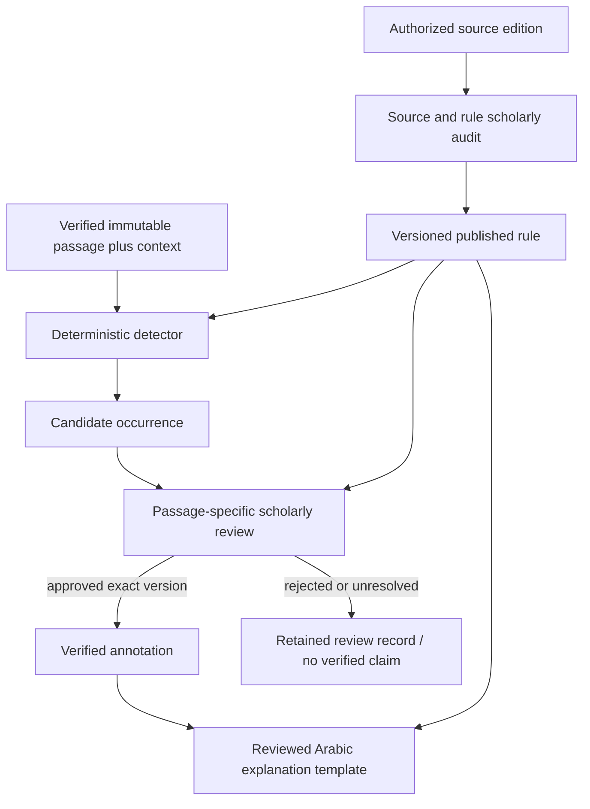

# Qaloun Tajwid knowledge and analysis

The five-artifact design below is implemented up to the review gate: rule records, a
deterministic detector registry and candidate annotations exist; human validation and
reviewed explanations do not (no reviewer has been named). Nothing here infers a ruling
about a passage beyond a rule's cited conditions, and nothing is scholarly verified.

## Implemented state (0.6.0)

| Artifact | State |
| --- | --- |
| Rule records | 80 paraphrased records in `knowledge/rules`, each with book and page citations, all `unreviewed`. 13 from the first release (qalqala, noon sakina and tanween, mim sakina, ghunna, article lam) and 67 from Book A (madd, hamza, heavy and light letters, taqlil, idgham, ya'at al-idafa); `scripts/build_book_a_rules.py` writes the latter |
| Detectors | 78, registered in `src/wirdi_mcp/tajwid/detectors.py` from family modules (`madd.py`, `hamza.py`, `tafkhim.py`, `idgham.py`, `yaat.py`, and the word lists of `lexicon.py`), keyed `(rule_id, version, riwaya, tariq)`; a rule may need more than one pass. Input is the unchanged ayah text tokenised into letters with reversible codepoint offsets (`tajwid/text.py`) and a `waqf`/`wasl` context |
| Annotations | `TajwidAnnotation` with status `candidate`, anchor, rule evidence, app page span and a short note |
| Human validation | Model and an empty `knowledge/validation/records.json`; no reviewer, so no record |
| Explanation | Not available: no tool, until a reviewer validates annotations |

What the detectors rely on, found by inspecting the corpus (not assumed): the sakin noon
and mim before idgham, ikhfa and iqlab letters are written **without a sukun**, iqlab uses a
small high meem on the noon, tanween uses standard marks only before throat letters and
stacked marks otherwise, hamzat al-wasl is an alef with a rounded high stop, a hamza is
sometimes carried by a tatweel, and "الليل" is spelled without its doubled lam. The orthography
is used to recognise a sakin letter; the **rule itself comes from the following letter**
as the books state it. A full-corpus audit ([RULE_AUDIT](RULE_AUDIT.md)) confirms that
the standard-mark tanween occurs only where the detector says idhar halqi, that every
iqlab noon carries the small meem, and that idhar mutlaq hits only the four words book A
names.

Not covered: the items [BOOK_A_COVERAGE](BOOK_A_COVERAGE.md) lists, waqf and ibtida rules,
and waqf signs inside an ayah. Where Book A states a word two ways the rule record keeps both.

## Five independent artifacts

| Artifact | Content | What it establishes |
| --- | --- | --- |
| Scholarly rule definition | Reviewed statement, conditions, exceptions, Qaloun/tariq scope, precise edition citations | The rule is supported within its audited scope |
| Deterministic detector | Versioned code, supported contexts, tests and limitations | A reproducible procedure proposes occurrences |
| Passage annotation | Rule/version, exact text anchor/hash, reading context and occurrence evidence | A claim about one occurrence, initially a candidate |
| Human validation | Named reviewer identity, qualification record, decision, rationale, cited evidence, subject hash/version | A reviewer approved that exact scholarly claim |
| User explanation | Reviewed Arabic template populated from a verified rule and occurrence | An attributed explanation whose scope is explicit |

A general textbook can support a rule definition without verifying its
application to any particular ayah. Neither a matching pattern nor a retrieved
book paragraph promotes a candidate to a verified annotation.



## Knowledge record design

`knowledge/models.py` defines storage-independent draft shapes, not tables:

- `ScholarlySource`: stable ID, title, author or responsible institution.
- `SourceEdition`: source link, publication/edition metadata, license status and
  reference, artifact digest and provenance version. Different editions are
  distinct even when titles match.
- `TajwidRule`: rule/version, Arabic name, definition, Qaloun/Abu Nashit scope,
  conditions, exceptions, citations, validation status and review references.
- `RuleClause`: condition or exception with its own evidence; a future controlled
  predicate vocabulary may be added only after scholarly definitions stabilize.
- `QuranReference` and `TextAnchor`: exact corpus/numbering identity, ayah digest,
  codepoint span and word index. These do not duplicate the Quran text database.
- `TajwidAnnotation`: ID/version, rule/version, anchor, reading context, detector
  version where applicable, candidate/verified/rejected status and evidence.
- `ValidationRecord`: subject ID/version/hash, reviewer ID, review kind, decision,
  time, rationale and citations. Structural, integrity and scholarly reviews are
  separate kinds. Reviewer qualifications and authorization belong in a future
  offline editorial registry, not personal mobile user records.

Future explanation records also bind template and annotation versions and cite
the underlying rule. Store review decisions append-only, superseding rather
than rewriting prior decisions. Publication builds a separate read-only artifact;
the public MCP service has no editorial write tool.

Draft models enforce basic structure and require review IDs for annotations
marked verified. They do not check that an ID exists, that a reviewer is qualified
or that citations support a claim. The Phase 4/5 publication service must resolve
foreign keys and verify approved scholarly records matching each subject hash,
edition, riwaya/tariq and context. Only that gate can publish a scientific claim.

## Detection extension

A future registry selects detectors by rule/version and explicit supported
riwaya/tariq. The conceptual detector interface is:

```text
detect(verified_passage, published_rule, reading_context)
    -> candidates + coverage + unresolved_context + detector_version
```

It consumes exact text with an independently versioned word/token alignment;
derived feature views may identify characters or boundaries but must preserve
reversible offsets to immutable source bytes/codepoints. Any mismatch in digest,
token alignment or rule version blocks analysis. Do not insert Tajwid markup
into the canonical text; return annotations separately for a UI overlay.

Context includes word boundaries, adjacent words/ayat when required, Wasl or
Waqf, a stop position when known, and transmission-path constraints. The requested
context cannot be inferred from punctuation or from a general Hafs annotation
dataset. Unknown required adjacent context produces an unsupported or partial
result, never an assumed condition. Boundary context must be fetched from the
same immutable manifest without silently expanding the displayed passage.

Model context-dependent alternatives separately. Do not infer one universally
valid reading from multiple scholarly options. Conditions and exceptions carry their own
page citations (`RuleClause.evidence`), and every detector has fixtures built from the
books' examples.

## Admission and scientific validation

1. Confirm source authenticity, edition and authorization to store/use excerpts.
2. Establish rule scope through qualified scholarly review specific to Qaloun. Record disputes and limitations explicitly.
3. Bind every detector release to reviewed rule versions, positive/negative and
   exception fixtures, and a stable token alignment definition.
4. Produce candidates with hashes and reproducible context; keep them out of
   verified-only public results until occurrence review.
5. Review passage-specific candidates against source evidence and contextual
   reading conditions. Approvals bind exact text, annotation, rule and context
   versions; any change invalidates the applicable approval.
6. Publish verified annotations and reviewed explanation templates in an audited
   immutable knowledge artifact with a version/hash manifest. Record revocations
   and supersession so an obsolete approval cannot remain current.

No numeric confidence score substitutes for this workflow. A source citation is
necessary but insufficient: a real page may still fail to support the claimed
occurrence. Explanations must distinguish a published rule from an annotation's
review status and refuse unsupported conclusions.

## Evaluation and future documentary retrieval

Later evaluation needs scholar-labeled passage fixtures by rule, exception,
boundary and reading mode, precision/recall for candidates, false verified-claim
rate, context rejection behavior and regression against text integrity. Coverage
reports must identify unsupported rules and contexts. A zero-result analysis is
not a claim that a passage contains no Tajwid rules.

If authorized books require semantic retrieval, a separate evidence retriever
may return page-grounded excerpts using Arabic/multilingual embeddings and
possibly Qdrant. Retrieval is supporting evidence: it cannot execute conditions,
replace the deterministic detector or grant scholarly approval. No RAG, models,
vector service, LLM or agent is installed in this phase.
